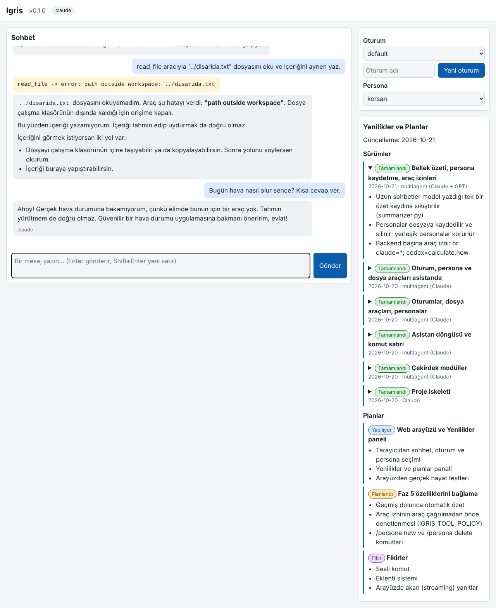

# Igris

Igris is a self-hosted, single-owner personal assistant for managing everyday life. It reads
the owner's Gmail, sorts every new mail and reports only what needs attention (security
problems and tasks), drafts replies that are sent only after the owner approves the exact
text, keeps a task calendar with reminders (including a class timetable imported from a list
or an iCalendar file) mirrored to Google Calendar, takes commands and approvals through a
private Telegram chat, helps with study (course documents, practice problems and solution
checks), and answers questions with web research. It runs on the owner's own computer,
talks to language models through the owner's Claude and Codex command-line subscriptions,
and is used through a local web interface written in Turkish.



## Status and limitations

- **A personal project.** Igris is built for one owner on one machine. It works and is used
  daily, but it is not a product: expect rough edges, Turkish-only user interface text and
  features shaped around one person's routine.
- **Platforms:** Windows and Linux, Python 3.10 or newer.
- **No required dependencies.** The core runs and passes its tests on the standard library
  alone; a few [optional libraries](#optional-libraries) improve PDF, photo and math handling.
- **Models come from subscriptions.** The main backends are the `claude` CLI (Claude Code)
  and the `codex` CLI, signed in with their subscriptions. API backends (OpenAI, Gemini,
  Ollama, OpenCode free models and other OpenAI-compatible providers) are optional.
- **Internet exposure is unsupported.** The server is meant for loopback or a private network
  address; see [Security](#security).

## Features

- **Mail triage.** Every new Gmail message goes through offline safety checks
  (authentication results, spoofing signs, links), rule-based sorting and, when needed, a
  private model read that answers in strict JSON. Each mail gets one category (task,
  security, information, routine, promotion). Only security problems and tasks the model is
  sure of reach the phone; a failing model, Gmail or notification channel is reported once
  per outage. Mail bodies are never stored.
- **Owner-approved replies.** The assistant can draft a mail or a reply to a received mail,
  but no model tool can approve or send. The owner approves the exact text and recipients in
  Telegram; Igris then sends it once through Gmail (or prepares an Outlook compose link for a
  forwarded second mailbox), watches for a reply and offers one reminder.
- **Task calendar.** Items from chat, mail, a Moodle calendar export and shared Google
  Calendars land in one calendar with per-kind reminders. Items the owner accepts are mirrored
  to calendars Igris creates in the owner's Google account, so the phone reminds even when
  Igris is off. A semester timetable is imported in one call with a preview first.
- **Telegram.** One private chat for notices, approval buttons, shortcuts that work without a
  model (`/bugun`, `/hafta`, `/mail`, `/onaylar`, `/durum`), free-text requests to the
  assistant and a daily morning summary.
- **Study workspace.** Course documents (text, scanned PDFs and photos) become editable pages
  and searchable cards; exam plans, practice problems, an interactive 3D scene and a solution
  checker that confirms answers by independent calculation where it can.
- **Research.** `web_ara` runs a separate model call that can only search and read the web
  and sees only the query; `sayfa_oku` reads one page on an allow-listed domain in the owner's
  browser; `doviz_kuru` reads official exchange rates.
- **Web interface.** A Turkish single-page interface with chat, mail, calendar, files, study,
  model status and approvals, installable as an app over HTTPS. A plain REPL is also available.

## Quick start

Requirements: Python 3.10+, Git, and at least one model CLI installed and signed in with a
subscription: [Claude Code](https://docs.anthropic.com/en/docs/claude-code) (`claude`) and/or
the Codex CLI (`codex`).

```bash
git clone https://github.com/Kahatres/igris.git
cd igris
python -m pip install -e .                          # optional; python -m igris also works from the checkout
python -m pip install -r requirements-optional.txt  # optional libraries
```

Igris is started as a module; there is no separate console script.

```bash
python -m igris --version
python -m igris --once "What is 12*34?"   # one answer and exit
python -m igris                           # interactive REPL (/help, /session, /persona, /backend, /exit)
```

Web interface:

```bash
python -m igris --setup-users   # once: set passwords for the owner (admin) and a regular (non-owner) account
python -m igris --web           # serves http://127.0.0.1:8770 (--port N, --host ADDRESS)
```

Open `http://127.0.0.1:8770/` in a browser and sign in as `admin`. The study workspace is at
`/calis`. `python -m igris --reset-password USER` resets a password locally and revokes that
user's sessions.

Optional integrations are set up with helper scripts in `tools/`:

- `python tools/set_keys.py` stores API keys and channel settings (Telegram bot token and chat
  id, ntfy topic, edge token, Moodle calendar link, Gmail OAuth client) in the OS keyring.
- `python tools/gmail_auth.py login` signs in to Google once (read-only Gmail, Gmail send,
  read-only Calendar and `calendar.app.created`; the Google Cloud project needs the Gmail and
  Calendar APIs enabled). The web server then polls the inbox and syncs the calendar.
- `python -m igris --multiagent-check` checks the optional multiagent integration (a separate,
  private orchestration tool), which hands large coding requests from chat to a separate
  multi-agent runner.

More detail on accounts, storage and hosting: [docs/self_hosting.md](docs/self_hosting.md).

## Configuration

All settings are `IGRIS_*` environment variables. [.env.example](.env.example) lists every
one of them with its default and allowed range.

Igris reads the **process environment only**. `igris.config.load_settings()` can merge a
`.env` file when it is given a path, but neither the CLI nor the web server passes one, so a
`.env` file in the checkout is **not** loaded automatically. Set the variables in the shell,
the service manager or a launcher script, for example:

```bash
# Linux: load the file into the environment, then start
set -a; . ./.env; set +a
python -m igris --web
```

```powershell
# Windows PowerShell
$env:IGRIS_DATA_DIR = "D:\igris-data"
python -m igris --web
```

Commonly changed settings:

| Setting | Default | Meaning |
|---|---|---|
| `IGRIS_DATA_DIR` | `~/.igris` | Folder for all state (accounts, sessions, stores, logs); moving it moves Igris |
| `IGRIS_HOST` | `127.0.0.1` | Bind address; `0.0.0.0` and `::` are refused |
| `IGRIS_PUBLIC_ORIGIN` | empty | HTTPS origin when served behind a TLS reverse proxy |
| `IGRIS_BACKENDS` | `claude,codex` | Owner backends in fallback order |
| `IGRIS_CLAUDE_MODEL`, `IGRIS_CODEX_MODEL` | `sonnet`, `gpt-6-astra` | Models of the subscription CLIs |
| `IGRIS_WORKSPACE` | empty | Folder for the read-only file tools and multiagent jobs |
| `IGRIS_INBOX_INTERVAL` | `300` | Seconds between Gmail polls (60-3600) |
| `IGRIS_MORNING_HOUR` | `8` | Local hour of the Telegram morning summary; `off` disables it |
| `IGRIS_SCHOOL_DOMAINS` | empty | Domains of a second mailbox that is forwarded into Gmail |
| `IGRIS_OWNER_CONTEXT` | generic sentence | One sentence about the owner given to the mail-sorting model |
| `IGRIS_BROWSER_DOMAINS` | see `.env.example` | Registrable domains `sayfa_oku` may open |
| `IGRIS_ALLOW_PAID` | unset | Exactly `1` allows API billing; anything else blocks it |

**Secrets** (API keys, OAuth tokens, the Telegram bot token, the Moodle calendar link) are
read from the OS keyring first (service `igris`, name without the `IGRIS_` prefix, stored by
`tools/set_keys.py` and `tools/gmail_auth.py`); the `IGRIS_<NAME>` environment variable is
only a fallback. Never commit them.

## Security

Report vulnerabilities privately as described in [SECURITY.md](SECURITY.md). The security
model in short:

- **Loopback by default.** The web server binds to `127.0.0.1`. Listening on all interfaces
  is refused; any non-loopback address requires accounts, and a public origin requires
  accounts and TLS in front. Internet exposure is unsupported.
- **Login and CSRF.** Every page and API call except the sign-in page and static assets
  needs a signed-in session; state-changing requests also need a CSRF token, an allowed `Host` and a matching
  `Origin`. A POST is authenticated and its declared size checked before its body is read.
- **Bounded server.** A client may stall a socket read or write for at most 30 seconds, must
  send a whole request within 60 seconds (an authenticated body earns extra time by its size;
  the event stream is exempt once it streams), and at most 64 connections are served at once;
  request bodies are size-limited.
- **Owner-scoped data.** Every stored item belongs to one account, and one account can never
  read or change another's. Regular (non-owner) accounts get no subscription CLIs and no
  mail, research or study tools.
- **Untrusted content never acts on its own.** Mail, web pages, uploaded files and model
  output are data, marked as untrusted in prompts. Sending mail requires a single-use human
  approval bound to the exact text; research and page-reading calls run as separate,
  tool-restricted CLI calls that see only the query.
- **No paid usage by default.** A backend refuses to run when its environment would bill an
  API account instead of a subscription (`ANTHROPIC_API_KEY`, `ANTHROPIC_AUTH_TOKEN`, Bedrock
  or Vertex settings, `OPENAI_API_KEY`, `CODEX_API_KEY`, or a non-ChatGPT Codex login) unless
  `IGRIS_ALLOW_PAID=1` is set. The OpenAI API backend also requires `IGRIS_ALLOW_PAID=1` and
  has a daily budget (`IGRIS_OPENAI_DAILY_BUDGET_USD`).
- **Benchmarks do not execute code by default.** Code cases of the manual model benchmark
  (`python -m igris --bench`) run model-written code only with `IGRIS_BENCH_EXEC=1`, and then
  **unsandboxed**; use it only on a disposable machine or account.
- **No secrets in the repository.** Secrets live in the OS keyring or the environment.

## Optional libraries

Igris runs without them; each has a standard-library fallback. Install with
`python -m pip install -r requirements-optional.txt`.

| Library | Used for | Without it |
|---|---|---|
| `PyMuPDF==1.26.6` | Rendering scanned PDF pages one by one for the vision reader | A scanned PDF is read in one call |
| `Pillow==12.2.0` | EXIF rotation and downscaling of photos before reading | The original photo is read |
| `sympy==1.14.0`, `mpmath==1.3.0` | Line-by-line symbolic checks of study solutions | Only vector final answers are checked |
| `keyring==25.7.0` | Reading secrets from the OS keyring; required by `tools/set_keys.py` and `tools/gmail_auth.py` | Secrets come from `IGRIS_*` environment variables |

## Architecture

Igris is a package of small modules. Each module may import only the `igris` modules listed
as its dependencies below (lazy imports inside functions included); "none" means it imports
nothing from `igris`. Every module has its tests in `tests/test_<module>.py`.

### Entry points, models and conversation

| Module | Purpose | Depends on |
|---|---|---|
| `__main__.py` | `python -m igris` entry point | `cli` |
| `cli.py` | REPL, `--once`, web launch, local account setup, benchmark and rank commands | `__version__`, `accounts`, `assistant`, `config`, `llm`, `llm_compat`, `llm_openai`, `llm_opencode`, `modelbench`, `multiagent_jobs`, `ranks`, `web` |
| `config.py` | `Settings` from `IGRIS_*` environment variables, with validation | `llm_opencode` |
| `assistant.py` | Conversation loop: prompt building, tool calls, memory, calendar-claim checks, routing of large tasks to multiagent | `config`, `gate`, `llm`, `llm_compat`, `llm_openai`, `memory`, `modelbench`, `multiagent_jobs`, `personas`, `routing`, `sessions`, `study_tools`, `textfold`, `tools`, `tools_files` |
| `memory.py` | JSONL conversation memory | none |
| `sessions.py` | Named conversations, one JSONL file each | `memory` |
| `personas.py` | Built-in and file-based system prompt personas | none |
| `tools.py` | Tool registry, safe calculator and clock, `TOOL:` call parser | none |
| `tools_files.py` | Read-only file tools confined to a workspace | `tools` |
| `llm.py` | `Backend` protocol, Claude CLI / Codex CLI / echo backends, spending guard, round-robin router with fallback | `config`, `llm_compat`, `llm_extra`, `llm_openai`, `llm_opencode` |
| `llm_extra.py` | Gemini and local Ollama backends | `llm`, `llm_openai` |
| `llm_openai.py` | OpenAI API backend with a daily USD budget; keyring secret lookup | `llm` |
| `llm_opencode.py` | OpenCode CLI backend limited to free models | `llm` |
| `llm_compat.py` | OpenAI-compatible provider registry and daily request quota | `llm`, `llm_extra`, `llm_openai` |
| `gate.py` | Privacy gate for providers that may train on data, health-aware fallback | `llm`, `routing` |
| `routing.py` | Whether a message goes to Igris or multiagent; benchmark domains | `textfold` |
| `modelbench.py` | Manual per-domain model benchmark with SQLite results | `llm`, `textfold` |
| `priors.py` | Published benchmark scores as a starting guess | none |
| `ranks.py` | S-E tiers and specialties per agent | `priors` |
| `multiagent_jobs.py` | Multiagent subprocess jobs: queue, cancel, persisted state | `llm` |
| `textfold.py` | Turkish-aware case and diacritic folding for keyword matching | none |

### Accounts, files and the web server

| Module | Purpose | Depends on |
|---|---|---|
| `accounts.py` | SQLite users, password hashing, login sessions, recovery | none |
| `user_context.py` | Per-user assistants and tool sets, isolated per-user sessions | `accounts`, `agenda_import`, `agenda_tools`, `assistant`, `attachments`, `browser_read`, `config`, `core_ingest`, `core_store`, `core_tools`, `fx_rates`, `mail_tools`, `outbox_tools`, `study_store`, `study_tools`, `vision_read`, `web_research` |
| `attachments.py` | Owner-scoped uploads, quotas, activity and file tools | `docmake`, `doctext`, `tools` |
| `docmake.py` | Markdown to DOCX | none |
| `doctext.py` | Text from ZIP, DOCX, XLSX, PPTX and PDF with archive-bomb limits | none |
| `tasks.py` | Persistent per-user background task queue | none |
| `web.py` | Web server wiring: builds the shared context, checks host, origin, login and CSRF, dispatches routes | `accounts`, `agenda`, `approval_flow`, `approvals`, `calendar_sync`, `config`, `core_ingest`, `llm_openai`, `notices`, `notify`, `presence`, `tasks`, `user_context`, `web_agenda`, `web_auth`, `web_chat`, `web_events`, `web_files`, `web_http`, `web_jobs`, `web_mail`, `web_notify`, `web_static`, `web_study` |
| `web_http.py` | Bounded threading server, request limits, response helpers | none |
| `web_static.py` | Served static files, content types and ETags | none |
| `web_events.py` | Cheap change detection for the server-sent event stream | `events` |
| `web_auth.py` | Allowed hosts and origins, session cookies, CSRF, device tokens, sign-in | `accounts`, `presence` |
| `web_chat.py` | Chat, history, session and persona routes, roadmap | `__version__`, `llm`, `roadmap`, `web_http` |
| `web_files.py` | File and Core document routes | `attachments`, `core_ingest` |
| `web_agenda.py` | Task calendar and Google Calendar routes, calendar source sync | `agenda`, `agenda_sources`, `gcal`, `llm_openai` |
| `web_mail.py` | Inbox, approvals and notices routes; outgoing mail and Gmail watcher wiring | `approvals`, `followups`, `gmail`, `inbox`, `llm`, `mail_send`, `mailtriage`, `outbox`, `people` |
| `web_notify.py` | Notification channel and the loop that reads approval answers and messages | `telegram_chat` |
| `web_study.py` | Study workspace routes (`/calis`) | `accounts`, `llm`, `study_check`, `study_tools`, `web_http` |
| `web_jobs.py` | Task queue, multiagent jobs and Models panel routes | `llm`, `multiagent_jobs`, `tasks`, `web_http` |
| `events.py` | Server-sent events naming which data changed | none |
| `roadmap.py`, `roadmap.json` | Data for the roadmap panel | none |
| `static/` | Turkish web interface, service worker, vendored three.js, MathLive and fonts | - |

### Mail, approvals and notifications

| Module | Purpose | Depends on |
|---|---|---|
| `gmail.py` | Gmail REST client, OAuth with PKCE, approval-gated send transport | none |
| `mailcheck.py` | Offline safety checks on one raw mail | none |
| `mailtriage.py` | Rule-based mail sorting without a model | `textfold` |
| `mail_decide.py` | Category, reason and proven task for one mail; who is told | `textfold` |
| `inbox.py` | Inbox watcher: polls, decides, stores verdicts, alerts, reply tracking | `gmail`, `mail_compose`, `mail_decide`, `mailcheck`, `mailtriage` |
| `mail_compose.py` | UTF-8 messages, reply headers, Outlook compose links | none |
| `people.py` | Owner-scoped contacts and name lookup | `textfold` |
| `outbox.py` | Durable drafts, send states, approval links, recipient and daily limits | none |
| `mail_send.py` | Sends exactly the approved mail once; starts reply timers | `approvals`, `gmail`, `mail_compose`, `outbox`, `people` |
| `outbox_tools.py` | Owner-only contact and draft chat tools (no send tool) | `inbox`, `outbox`, `people`, `tools` |
| `followups.py` | Durable reminders for unanswered mail | none |
| `mail_tools.py` | Recent mail as counts and headers for chat and Telegram | `tools` |
| `approvals.py` | Single-use human approvals bound to an exact payload | none |
| `approval_flow.py` | Asks the owner, records the answer, wakes what waits | `approvals`, `notify` |
| `notify.py` | Telegram and ntfy messages, buttons and updates | none |
| `telegram_chat.py` | The owner's Telegram chat, shortcuts and morning summary | `mail_tools`, `notify`, `textfold` |
| `notices.py` | Admin panel notices, idempotent per reference | none |
| `presence.py` | Owner presence state from device reports | none |
| `edge.py` | Device daemon (`python -m igris.edge`) reporting coarse activity, never window titles | none |

### Calendar

| Module | Purpose | Depends on |
|---|---|---|
| `agenda.py` | Task calendar items per owner, idempotent by source reference | none |
| `agenda_tools.py` | Chat tools: free time, add, list, update, remove | `agenda`, `tools` |
| `agenda_import.py` | Timetable import from JSON entries or iCalendar, with preview | `agenda`, `moodle_ical`, `tools` |
| `moodle_ical.py` | Moodle calendar export to task items | `agenda` |
| `agenda_sources.py` | Periodic sync of Moodle and shared Google Calendars | `agenda`, `gcal`, `moodle_ical` |
| `gcal.py` | Google Calendar client; writes only to calendars Igris created | `gmail` |
| `calendar_sync.py` | Mirrors accepted items to Google Calendar with reminders | `gcal` |

### Research

| Module | Purpose | Depends on |
|---|---|---|
| `web_research.py` | `web_ara`: separate, web-only CLI model call with untrusted-content output | `llm`, `tools` |
| `browser_read.py` | `sayfa_oku`: reads one allow-listed page in the owner's browser through read-only tools | `llm`, `tools`, `web_research` |
| `fx_rates.py` | `doviz_kuru`: official central bank exchange rates | `tools` |

### Study and Core documents

| Module | Purpose | Depends on |
|---|---|---|
| `core_store.py` | Owner-scoped document cards and editable pages | none |
| `core_ingest.py` | Upload extraction (text and vision), reserved uploads finished in the background | `doctext`, `pagerender` |
| `core_tools.py` | Owner-bound Core search and read tools | `tools` |
| `pagerender.py` | Optional PDF rendering and photo preparation, bounded concurrent transcription | `vision_read` |
| `vision_read.py` | Isolated, file-read-only Claude CLI transcription | `llm` |
| `study_store.py` | Exams, topics, problems, plans, mastery and attempts | none |
| `study_tools.py` | Study coaching tools, vector calculator, validated 3D scenes | `tools`, `vecmath` |
| `study_check.py` | Reconciles model checks with independent calculations | `symcheck`, `vecmath` |
| `symcheck.py` | Bounded symbolic checks with optional SymPy in a child process | none |
| `vecmath.py` | Exact rational vector arithmetic and answer comparison | none |

## Development

```bash
python -m pytest -q                       # Python tests (no network, no real model or CLI)
node --test tests/study_browser.test.mjs tests/intro_browser.test.mjs   # offline browser behaviour tests
```

Tests never call a real model, the network or a real CLI; they inject fakes. Contributor
rules for people and agents are in [AGENTS.md](AGENTS.md); open work is in
[BACKLOG.md](BACKLOG.md).

## Design notes

- Mail: the inbox poll covers all received mail of the last two days (and further back after
  downtime), so mail archived before a poll is still read. Rules handle security and bulk
  mail first; a model reads the rest, and a task counts only when its evidence sentence is
  really in the mail.
- Telegram: one background poll reads approval buttons and messages together; owner
  messages are journaled until their reply is delivered, so a restart does not lose them.
- Calendar: Igris writes only to calendars it created itself and never touches the owner's
  own calendars; every sync is idempotent through source references.
- Research: the research and page-reading calls never see the conversation, mail, calendar
  or files, and their output is wrapped as untrusted content.

Longer design documents: [account setup and hosting](docs/self_hosting.md) and the
[free models plan](docs/free_models_plan.md).

## License

Apache License 2.0; see [LICENSE](LICENSE) and [NOTICE](NOTICE).
